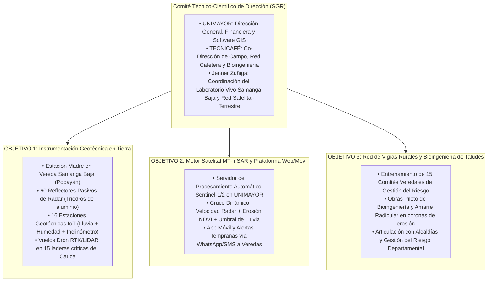

# FICHA TÉCNICA, PRESUPUESTO Y CRONOGRAMA MGA-SGR: SISTEMA SATELITAL DE ALERTA TEMPRANA DE DERRUMBES Y ESTABILIDAD DE LADERAS — PILOTO SAMANGA BAJA (TRL 6)
**Mecanismo de Financiación:** Sistema General de Regalías (SGR) — Asignación para la Ciencia, Tecnología e Innovación (Ley 2056 de 2020 / OCAD CTeI Minciencias — Línea *Vida y Entorno / Gestión del Riesgo de Desastres*)  
**Duración del Proyecto:** **24 meses (8 Trimestres: `T1` a `T8`)**  
**Alianza Estratégica Bipartita + Laboratorio Vivo:**  
* **Entidad Pública Proponente y Ejecutora (SNCTI):** Institución Universitaria Colegio Mayor del Cauca (**UNIMAYOR** — Popayán)  
* **Co-Ejecutor Tecnológico y Sectorial (SNCTI):** Parque Tecnológico de Innovación del Café (**TECNICAFÉ** — Cajibío, Cauca)  
* **Estación Madre y Laboratorio Vivo (*Living Lab* TRL 6):** **Vereda Samanga Baja — Popayán** (Investigador Proponente: **Jenner Zúñiga**)

---

## 1. EL PROYECTO EN CONCRETO: ¿QUÉ PROBLEMA RESUELVE Y CÓMO FUNCIONA?

### 1.1. El Problema en el Cauca: Derrumbes Silenciosos en Zonas de Ladera y Falla Geológica
El departamento del Cauca (Popayán, Rosas, Timbío, Cajibío, El Tambo, Sotará y Puracé, sobre el **Sistema de Fallas de Romeral**) sufre periódicamente **movimientos en masa (derrumbes, deslizamientos lentos y pérdida de banca vial)** que destruyen viviendas rurales, fincas cafeteras, acueductos veredales y vías terciarias. Antes de que una montaña colapse en invierno o tras un sismo, el suelo presenta una **reptación precursora de $2\text{ a }15\text{ mm/mes}$** invisible al ojo humano.

### 1.2. Solución Tecnológica (Radar Satelital + Índice de Amarre Radicular + Reflectores en Tierra)
1. **Radar Satelital Todo-Clima (`Sentinel-1C MT-InSAR PS/SBAS`):** Atraviesa las nubes y mide cada 12 días con **precisión milimétrica** el hundimiento vertical ($V_{\text{AA}}$) y el desplazamiento lateral ($V_{\text{EO}}$) de laderas, vías y construcciones rurales.
2. **Detección Geotécnica de Suelo Desprotegido y Coronas de Derrumbe (`Sentinel-2 NDVI a 10 m`):** Evalúa el amarre radicular del bosque y sombrío cafetero ($\text{NDVI} \ge 0.70$ en el $91.6\%$ de **Samanga Baja**) y detecta al instante desgarres de capa vegetal, cárcavas de erosión o grietas de corona de deslizamiento ($\text{NDVI} < 0.35$).
3. **Red Terrestre de Reflectores Pasivos de Radar (Triedros Metálicos) y Sensores Geotécnicos IoT:** Instalación en taludes críticos de **esquinas reflectoras triangulares de aluminio (sin baterías ni electricidad)** que actúan como espejos exactos para el satélite Sentinel-1C, combinadas con pluviómetros, piezómetros e inclinómetros de suelo.

---

## 2. ESTRUCTURA TÉCNICA Y GOBERNANZA DE LA ALIANZA (`UNIMAYOR + TECNICAFÉ + SAMANGA BAJA`)

---

## 3. PRESUPUESTO DETALLADO DEL PROYECTO SGR (24 MESES — CIFRAS EN PESOS COLOMBIANOS)

* **Alcance Territorial:** **1 Estación Madre de Calibración (Vereda Samanga Baja, Popayán)** + **15 Microcuencas/Laderas Cafeteras Críticas del Cauca** (Popayán, Timbío, Cajibío, Rosas, Sotará, Puracé, El Tambo, Inzá, Morales, Piendamó).
* **Valor Total del Proyecto:** **\$3.450.000.000 COP** (\$3.450 millones): **\$3.000.000.000 COP SGR (87%)** + **\$450.000.000 COP Contrapartida en Especie (13%)**.

| Rubro MGA / Actividad Principal | Entidad Responsable | Aporte Regalías SGR (COP) | Contrapartida en Especie (COP) | Total Rubro (COP) | Detalle Técnico del Gasto |
| :--- | :---: | :---: | :---: | :---: | :--- |
| **1. Talento Humano Especializado e Investigadores (24 meses)** | **UNIMAYOR + TECNICAFÉ + Coordinación Samanga Baja** | \$1.180.000.000 | \$260.000.000 | **\$1.440.000.000** | • **Coordinador Técnico del Laboratorio Vivo y Red Satelital-Campo (Jenner Zúñiga — 24 meses)**. • 2 Geotecnistas / Especialistas InSAR. • 2 Desarrolladores Senior GIS / Full-Stack (UNIMAYOR). • 4 Ingenieros de Campo (TECNICAFÉ) + 6 Semilleros UNIMAYOR. |
| **2. Red de Reflectores Pasivos de Radar y Estaciones Geotécnicas IoT** | **TECNICAFÉ + Laboratorio Vivo Samanga Baja** | \$680.000.000 | \$70.000.000 | **\$750.000.000** | • **60 Reflectores de Esquina Pasivos (Triedros de aluminio de $0.8\text{ m}$ con base geodésica en concreto)** ($12$ en Samanga Baja + $48$ en 15 laderas del Cauca). • **16 Estaciones Geotécnicas Automáticas LoRaWAN** (pluviómetro, humedad/presión de poros e inclinómetro MEMS). |
| **3. Equipos de Cómputo HPC, Dron RTK/LiDAR y GNSS Diferencial** | **UNIMAYOR** | \$460.000.000 | \$40.000.000 | **\$500.000.000** | • 1 **Dron Matriz RTK con sensor LiDAR y cámara multiespectral**. • 1 **Receptor GNSS RTK doble frecuencia** (base + rover). • **Servidor GPU/HPC en UNIMAYOR** para corrida continua de escenas Sentinel-1 SLC. |
| **4. Desarrollo de Plataforma Web/Móvil y Sistema de Alertas Tempranas** | **UNIMAYOR** | \$260.000.000 | \$30.000.000 | **\$290.000.000** | • Escalamiento del visor actual ([dashboard/index.html](file:///c:/Copernico/dashboard/index.html)) a plataforma en la nube, **App Móvil Android/iOS** y alertas automáticas por **WhatsApp / SMS**. |
| **5. Obras Piloto de Bioingeniería de Taludes y Red de Vigías Rurales** | **TECNICAFÉ + Samanga Baja** | \$240.000.000 | \$50.000.000 | **\$290.000.000** | • Adecuación de la **Estación Demostrativa en Samanga Baja**, obras piloto de bioingeniería en taludes con $\text{NDVI} < 0.35$ y 15 comités veredales de vigías. |
| **6. Administración, Interventoría, Publicaciones y Contingencias SGR** | **UNIMAYOR** | \$180.000.000 | \$0 | **\$180.000.000** | • Administración SGR, pólizas, auditoría, artículos científicos Q1/Q2 y registro de software ante la DNDA. |
| **TOTAL PROYECTO (24 MESES)** | **ALIANZA CAUCA** | **\$3.000.000.000** *(87%)* | **\$450.000.000** *(13%)* | **\$3.450.000.000** *(100%)* | **Presupuesto equilibrado de alta viabilidad en evaluación OCAD CTeI.** |

---

## 4. CRONOGRAMA DE EJECUCIÓN FÍSICA Y FINANCIERA (24 MESES / 8 TRIMESTRES)

```mermaid
flowchart LR
    T1["T1 (Meses 1–3)<br/>Alistamiento y Compras<br/>Estación Madre Samanga Baja"] --> T2["T2 (Meses 4–6)<br/>12 Reflectores en Samanga<br/>Servidor HPC y Dron LiDAR"]
    T2 --> T3["T3 (Meses 7–9)<br/>24 Reflectores en 8 Veredas<br/>Motor Automático MT-InSAR"]
    T3 --> T4["T4 (Meses 10–12)<br/>24 Reflectores en 7 Veredas<br/>App Móvil Beta (Hito 50%)"]
    T4 --> T5["T5 (Meses 13–15)<br/>Calibración Invernal<br/>Alertas WhatsApp/SMS"]
    T5 --> T6["T6 (Meses 16–18)<br/>Obras Bioingeniería Taludes<br/>15 Comités Vigías Rurales"]
    T6 --> T7["T7 (Meses 19–21)<br/>Validación Geotécnica Total<br/>Simulacros en 16 Veredas"]
    T7 --> T8["T8 (Meses 22–24)<br/>Entrega a Alcaldías/SGR<br/>Publicación y Cierre (100%)"]
```

### 4.1. Matriz de Programación Trimestral MGA (`T1` a `T8`)

| ID | Objetivo / Actividad MGA | Responsable | T1 <small>M1-3</small> | T2 <small>M4-6</small> | T3 <small>M7-9</small> | T4 <small>M10-12</small> | T5 <small>M13-15</small> | T6 <small>M16-18</small> | T7 <small>M19-21</small> | T8 <small>M22-24</small> | Entregable / Hito Verificable SGR |
| :-: | :--- | :---: | :-: | :-: | :-: | :-: | :-: | :-: | :-: | :-: | :--- |
| **0.1** | Contratación de equipo base, licitaciones de equipos y puesta en marcha de la **Estación Madre en Samanga Baja** | **UNIMAYOR + Samanga Baja** | ██ | | | | | | | | Acta de inicio, equipo contratado y estación base en Samanga Baja |
| **1.1** | Adquisición de **Dron RTK/LiDAR, GNSS doble frecuencia** y levantamiento topográfico de 16 laderas críticas | **UNIMAYOR + TECNICAFÉ** | ██ | ██ | ██ | | | | | | Modelos Digitales de Elevación (DEM) centimétricos de 16 taludes |
| **1.2** | Fabricación e instalación de **12 Reflectores Pasivos (Triedros) y Estación IoT Madre en Samanga Baja** | **Samanga Baja + TECNICAFÉ** | | ██ | | | | | | | 12 reflectores calibrados con el paso orbital de Sentinel-1C |
| **1.3** | Despliegue regional de **48 Reflectores Pasivos de Radar y 15 Estaciones Geotécnicas IoT** en 15 veredas del Cauca | **TECNICAFÉ + Samanga Baja** | | | ██ | ██ | | | | | Red completa de 60 reflectores y 16 estaciones IoT transmitiendo |
| **2.1** | Instalación de **Servidor HPC/GPU** en UNIMAYOR y automatización del pipeline **Sentinel-1 MT-InSAR + Sentinel-2 NDVI** | **UNIMAYOR + Samanga Baja** | ██ | ██ | ██ | | | | | | Procesamiento automático cada 12 días de las 16 microcuencas |
| **2.2** | Calibración del modelo geotécnico (cruce de velocidad radar $V_{\text{AA}}/V_{\text{EO}}$ + pérdida radicular $\text{NDVI}$ + lluvia) | **UNIMAYOR + TECNICAFÉ** | | | ██ | ██ | ██ | ██ | | | Umbrales críticos de alerta de derrumbe calibrados por vereda |
| **2.3** | Desarrollo de **Plataforma Web en la Nube, App Móvil Android/iOS y pasarela de alertas SMS/WhatsApp** | **UNIMAYOR** | | ██ | ██ | ██ | ██ | | | | App móvil publicada y registro de software ante la DNDA |
| **3.1** | Obras piloto de **bioingeniería y amarre radicular** en coronas de deslizamiento detectadas con $\text{NDVI} < 0.35$ | **TECNICAFÉ + Samanga Baja** | | | | | ██ | ██ | ██ | | 16 taludes críticos intervenidos con bioingeniería viva |
| **3.2** | Conformación de **15 Comités Veredales de Vigías Geotécnicos**, simulacros comunitarios y transferencia a Alcaldías | **TECNICAFÉ + UNIMAYOR** | | | | | | ██ | ██ | ██ | 300 productores capacitados, simulacros y cierre técnico-financiero |
| **%** | **Porcentaje de Ejecución Financiera Trimestral ($3.450M)** | **Flujo de Caja SGR** | **14%** | **22%** | **16%** | **14%** | **10%** | **10%** | **8%** | **6%** | **100% Ejecutado ($3.450.000.000 COP)** |

---

## 5. LÍNEA BASE GEOTÉCNICA YA DEMOSTRADA EN EL PILOTO (SAMANGA BAJA, PURACÉ Y SOTARÁ — 2026)

| Zona Monitoreada | Técnica Radar | Incidencia ($\theta$) | Puntos Medidos (`CD`) | Estabilidad $\text{ASI}$ | Coherencia ($\gamma$) | Hundimiento / Alzamiento $V_{\text{AA}}$ | Desplazamiento Lateral $V_{\text{EO}}$ | Estado del Talud y Protección Radicular ($\text{NDVI}$ $10\text{ m}$) |
| :--- | :---: | :---: | :---: | :---: | :---: | :---: | :---: | :--- |
| **Vereda Samanga Baja** *(Taludes e Infraestructura)* | **PS** | $36.91^\circ$ | **78,231 pts** | $0.768$ | $0.918$ | **$+0.05\text{ mm/año}$** | $+0.06\text{ mm/año}$ | **Ladera Estable · $\text{NDVI} = 0.817$** ($91.6\%$ con cobertura densa de amarre radicular) |
| **Vereda Samanga Baja** *(Suelo y Laderas Abiertas)* | **SBAS** | $36.91^\circ$ | **37,802 pts** | $0.664$ | $0.858$ | **$+0.19\text{ mm/año}$** | $+0.25\text{ mm/año}$ | **Sin reptación activa** ($1.9\%$ de suelo expuesto/vías bajo vigilancia) |
| **Volcán Puracé** *(Flancos y Drenajes)* | **PS / SBAS** | $35.53^\circ$ | **72,556 pts** | $0.730$ | $0.896$ | **$-0.12\text{ a }-0.21\text{ mm}$** | $-0.17\text{ a }-0.29\text{ mm}$ | Vigilancia de deformación volcánica y cabeceras de avalanchas/lahares |
| **Complejo Volcánico Sotará** *(Laderas de Alta Montaña)* | **PS / SBAS** | $36.64^\circ$ | **59,686 pts** | $0.720$ | $0.890$ | **$-0.11\text{ a }-0.18\text{ mm}$** | $-0.15\text{ a }-0.24\text{ mm}$ | Monitoreo de estabilidad estructural en macizo andino |

