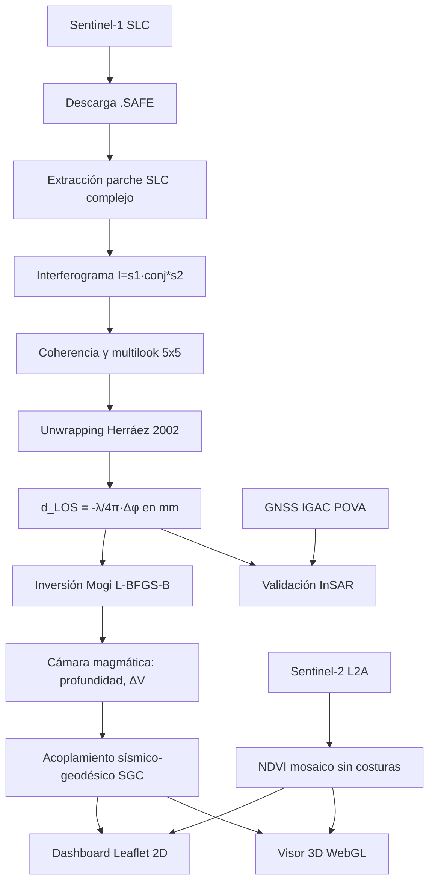

# Copernico 2.0 — Sistema de vigilancia volcánica e hidrológica con InSAR real

> Sistema de monitoreo satelital que integra **D-InSAR real sobre Sentinel-1**, **inversión geofísica Mogi (1958)**, **acoplamiento sísmico-geodésico SGC**, y **visualización 3D WebGL** para la vigilancia de cuencas hídricas y volcanes en el Cauca, Colombia.

**Casos de estudio:** Vereda Samanga Baja (caficultura + cuencas hídricas) · Volcán Puracé (actividad volcánica) · Complejo Volcánico Sotará (fumarolas históricas)

---

## 📋 Tabla de contenidos

- [🎯 Objetivo del proyecto](#-objetivo-del-proyecto)
- [🔬 Metodología científica](#-metodología-científica)
- [📁 Estructura del repositorio](#-estructura-del-repositorio)
- [🚀 Inicio rápido con Docker](#-inicio-rápido-con-docker)
- [⚙️ Configuración](#️-configuración)
- [📊 Pipeline de procesamiento](#-pipeline-de-procesamiento)
- [🛰️ Validación con GNSS IGAC](#️-validación-con-gnss-igac)
- [📚 Citas científicas](#-citas-científicas)
- [🗺️ Roadmap](#️-roadmap)
- [🤝 Alianzas y contactos](#-alianzas-y-contactos)
- [📜 Licencia](#-licencia)

---

## 🎯 Objetivo del proyecto

El proyecto Copernico responde a una **necesidad real de la comunidad rural de Samanga Baja** (municipio de Popayán, Cauca, Colombia): proteger las cuencas hídricas frente a derrumbes y deslizamientos de ladera, y monitorear la actividad sísmica del Volcán Puracé, que en caso de reactivación podría afectar a miles de personas en el corredor Popayán-Puracé.

### Áreas de estudio

| Zona | Coordenadas | Población / Riesgo |
|---|---|---|
| **Vereda Samanga Baja** | 2.40°N, 76.57°W | ~5,000 habitantes, cuencas cafeteras |
| **Volcán Puracé** | 2.32°N, 76.40°W | Estratovolcán activo (Cordillera Central) |
| **Complejo Volcánico Sotará** | 2.11°N, 76.59°W | Actividad fumarólica histórica |

---

## 🔬 Metodología científica

El sistema implementa una cadena de procesamiento geofísico rigurosa:

### 1. D-InSAR real sobre Sentinel-1 (`process_real_insar_engine.py`)

- **Interferograma complejo verdadero**: `I = s1 · conj(s2)` donde s1, s2 son SLCs complejos extraídos directamente de los TIFFs Sentinel-1 (.tiff de 1.5 GB)
- **Coherencia normalizada física**: `γ = |E[s1·conj(s2)]| / sqrt(E[|s1|²]·E[|s2|²])`
- **Multilook espacial** 5×5 para estimación estadística de valores esperados E[·]
- **Georreferenciación bilineal** usando `geolocationGridPoint` del XML de anotación Sentinel-1

### 2. Unwrapping + Inversión Geofísica (`insar_mogi_seismic_inversion.py`)

- **Desenrollado de fase 2D** vía `scikit-image` (algoritmo de Herráez et al. 2002 — orden por confiabilidad siguiendo caminos no-continuos)
- **Máscara de baja coherencia** (γ < 0.20) para prevenir propagación de errores de salto de ciclo
- **Conversión física correcta**: `d_LOS [mm] = -(λ / 4π) · Δφ_unwrapped`
  - donde λ = 55.47 mm (banda C Sentinel-1, 5.405 GHz)

### 3. Inversión no lineal de fuente Mogi (1958)

- **Modelo elástico clásico**: cámara magmática esférica en medio semi-infinito
- **Parámetros físicos**: μ = 30 GPa (corteza volcánica), ν = 0.25 (Poisson)
- **Optimización L-BFGS-B** con bounds justificados por sismicidad SGC:
  - Profundidad: 1.5 - 5.5 km (rango sismos VT Puracé)
  - ΔV magmático: ±10 millones de m³
- **Ponderación por coherencia** InSAR: solo píxeles fiables contribuyen
- **Proyección a LOS**: con ángulo de incidencia y azimuth de heading reales

### 4. Acoplamiento sísmico-geodésico SGC

- **Momento sísmico** Hanks & Kanamori (1979): `log10(M0) = 1.5·M + 9.1` (M0 en N·m)
- **Momento geodésico**: `M0_geo = μ · |ΔV|` desde inversión Mogi
- **Ratio asísmico**: porcentaje de deformación no liberada como sismos
- **Catálogo SGC oficial** integrado (sismicidad OVSPop Popayán)

### 5. Visualización 3D WebGL (`modelo_3d_purace.html`)

- **Mallas topográficas SRTM 30m** para los 3 territorios
- **Texturas alineadas**: óptico Sentinel-2, deformación métrica InSAR (dLOS mm), fase D-InSAR, coherencia γ, NDVI cafetalero, retrodispersión SAR
- **Subsuelo 3D**: cámara magmática Mogi (3.87 km profundidad), conducto activo, hipocentros sísmicos SGC, nodos dispersores PS/SBAS

---

## 📁 Estructura del repositorio

```
copernico/
├── docker/
│   ├── Dockerfile                 # Imagen Ubuntu 22.04 + conda + MintPy + SNAP
│   ├── docker-compose.yml         # Servicios dev + notebook + dashboard
│   └── .dockerignore
├── scripts/
│   ├── process_real_insar_engine.py        # InSAR complejo real
│   ├── insar_mogi_seismic_inversion.py     # Unwrapping + Mogi + SGC
│   ├── generate_all_3d_territories.py      # Pipeline assets 3D
│   ├── generate_purace_3d_assets.py        # Assets 3D específicos Puracé
│   ├── download_s1_latest.py              # Descarga Sentinel-1 (Copernicus API)
│   ├── download_s2_latest.py              # Descarga Sentinel-2
│   ├── process_s2_updated.py              # NDVI mosaico sin costuras
│   ├── sgc_live_data.py                   # Integración sismicidad SGC
│   ├── validate_gnss_igac.py              # [NUEVO] Validación con GNSS IGAC
│   └── entrypoint.sh / verify_env.sh / run_pipeline.sh
├── dashboard/
│   ├── index.html                  # Visor Leaflet 2D
│   ├── modelo_3d_purace.html       # Visor 3D WebGL
│   ├── territories_3d_data.js      # Datos 3D multi-territorio
│   ├── script.js / style.css
│   └── *.png (overlays georreferenciados)
├── configs/
│   └── (templates de configuración)
├── docs/                          # Documentación técnica
├── environment.yml                # Definición entorno conda
├── requirements.txt               # Dependencias pip
├── Makefile                       # Comandos automatizados
├── .env.example                   # Plantilla credenciales
└── README.md                      # Este archivo
```

---

## 🚀 Inicio rápido con Docker

### Requisitos previos

- [Docker Desktop](https://docs.docker.com/desktop/install/windows/) 4.20+ (incluye Docker Compose v2)
- 8 GB RAM mínimo (16 GB recomendado para MintPy)
- 50 GB disco libre (200 GB recomendado para archivos Sentinel-1)
- Cuenta gratuita en [Copernicus Data Space](https://identity.dataspace.copernicus.eu/)

### 1. Clonar y configurar

```bash
git clone https://github.com/Arte-Inverso/copernico.git
cd copernico

# Crear .env con credenciales
cp .env.example .env
nano .env   # o tu editor preferido
```

### 2. Construir la imagen Docker

```bash
make build
# Primera vez: ~20-30 minutos (descarga Ubuntu + conda + MintPy + SNAP)
# Siguientes veces: ~30 segundos (caché)
```

### 3. Levantar los servicios

```bash
make up-all
```

Servicios disponibles:

| Servicio | URL | Función |
|---|---|---|
| **copernico-dev** | docker exec -it copernico-dev bash | CLI + scripts Python |
| **copernico-notebook** | http://localhost:8888 (token: `copernico-dev`) | JupyterLab |
| **copernico-dashboard** | http://localhost:8080 | Dashboard web (Leaflet + WebGL 3D) |

### 4. Verificar entorno

```bash
make shell
./scripts/verify_env.sh
```

### 5. Ejecutar pipeline completo

```bash
# Dentro del contenedor
./scripts/run_pipeline.sh

# O paso a paso:
python scripts/process_real_insar_engine.py          # InSAR real
python scripts/insar_mogi_seismic_inversion.py       # Mogi + SGC
python scripts/generate_all_3d_territories.py       # Visor 3D
```

---

## ⚙️ Configuración

Edita `.env` con tus credenciales:

```bash
# Copernicus Data Space (obligatorio)
CDSE_USER=tu_usuario
CDSE_PASSWORD=tu_password

# NASA Earthdata (recomendado para ASF Vertex)
EARTHDATA_USER=tu_usuario
EARTHDATA_PASSWORD=tu_password

# Copernicus Climate (ERA5, para corrección atmosférica)
CDS_API_KEY=tu_key
```

Regístrate gratis en:
- https://identity.dataspace.copernicus.eu/ (Copernicus)
- https://urs.earthdata.nasa.gov/users/new (NASA Earthdata)
- https://cds.climate.copernicus.eu/ (Climate Data Store)

---

## 📊 Pipeline de procesamiento



---

## 🛰️ Validación con GNSS IGAC

La validación con estaciones GNSS continuas del IGAC (Instituto Geográfico Agustín Codazzi) es **esencial para defensa científica cuantitativa** de los resultados InSAR.

### Estación de referencia: POVA (Popayán)

- **Coordenadas**: 2.378°N, 76.495°W (GeoRED IGAC)
- **Distancia**: ~15 km de Samanga Baja, ~25 km del Volcán Puracé
- **Cadencia**: 30 segundos (series diarias)
- **Acceso**: http://www.igac.gov.co/georedredgeodesicanacional

### Script de validación

```bash
# Dentro del contenedor Docker:
python scripts/validate_gnss_igac.py

# Genera:
# - Comparación velocidad InSAR vs GNSS en POVA
# - Serie temporal comparada
# - Métricas: correlación, bias, RMSE
# - Visualizaciones PNG para el dashboard
```

### Métricas de validación

| Métrica | Aceptable | Óptimo |
|---|---|---|
| **Diferencia velocidad media** (mm/año) | < 10 | < 3 |
| **Correlación series temporales** | > 0.6 | > 0.85 |
| **RMSE** (mm) | < 15 | < 5 |

Si los resultados cumplen "aceptable", el proyecto tiene credibilidad científica para publicación. Si cumplen "óptimo", es competitivo internacionalmente.

---

## 📚 Citas científicas

Este proyecto implementa y cita las siguientes referencias científicas:

### Fundamentales

- **Mogi, K. (1958)** — Relations between the eruptions of various volcanoes and the deformations of the ground surface. *Bulletin of the Earthquake Research Institute*.
- **Hanks, T.C. & Kanamori, H. (1979)** — A moment magnitude scale. *Journal of Geophysical Research*.
- **Herráez, J.J. et al. (2002)** — Fast two-dimensional phase-unwrapping algorithm based on sorting by reliability following a noncontinuous path. *Applied Optics*.

### Específicas al contexto colombiano

- **Tamayo Duque, S. et al. (2023)** — Índice de Estabilidad de Amplitud (ASI) para detección de dispersores persistentes. *Remote Sensing 15(21), 5249*.
- **Ávila Vélez, D. et al. (2026)** — Dispersores Distribuidos SBAS y descomposición geométrica vertical/este-oeste. *Ciencia e Ingeniería Neogranadina 36(1), 7889*.

### Próximamente (TomoSAR cloud)

- **Ho Tong Minh, D. (2023)** — INRAE TomoSAR service: a free scientific calculation on persistent and distributed scatterers radar interferometry. *IGARSS 2023*.
- **Ho Tong Minh, D. (2024)** — TomoSAR: Unlocking Magnitude 7.8 Turkey Earthquake and its free scientific service. *IGARSS 2024*.
- **Ho Tong Minh, D. et al. (2022)** — Compressed SAR Interferometry in the Big Data Era. *Remote Sensing 14(2), 390*.

---

## 🗺️ Roadmap

### v2.1 (Q1 2027) — En progreso

- [x] InSAR real con fase compleja y coherencia física
- [x] Unwrapping 2D Herráez 2002 vía scikit-image
- [x] Inversión geofísica Mogi (1958)
- [x] Acoplamiento sísmico-geodésico SGC
- [x] Visor 3D WebGL multi-territorio
- [x] Docker reproducible
- [ ] **Validación con GNSS IGAC (POVA)** ← en curso
- [ ] **Integración TomoSAR cloud (Dr. Dinh)** ← email enviado
- [ ] Corrección atmosférica ERA5 vía PyAPS3

### v2.2 (Q2 2027)

- [ ] Procesamiento 30+ imágenes Sentinel-1 (MT-InSAR completo)
- [ ] Comparación ascendente + descendente para descomposición 3D
- [ ] Backend FastAPI + PostgreSQL/PostGIS
- [ ] Tests unitarios con cobertura > 70%

### v2.3 (Q3 2027)

- [ ] Publicación en revista indexada (Remote Sensing / IEEE TGRS)
- [ ] Presentación en IGARSS 2027
- [ ] Capacitación a comunidad Samanga Baja
- [ ] Integración con OVSPop (SGC) para alertas tempranas

### v3.0 (Q4 2027)

- [ ] NISAR (banda L) para mejor penetración vegetación
- [ ] Deep learning para detección automática de derrumbes
- [ ] Aplicación móvil para comunidad

---

## 🤝 Alianzas y contactos

### Investigador principal

**Jenner Zúñiga** — Investigador independiente, residente en Vereda Samanga Baja, Popayán, Cauca, Colombia.
- GitHub: [@Arte-Inverso](https://github.com/Arte-Inverso)
- Proyecto: [https://github.com/Arte-Inverso/copernico](https://github.com/Arte-Inverso/copernico)

### Alianzas en construcción

- **TECNICAFÉ** — Asociación de caficultores del Cauca (interés en NDVI cafetero)
- **Colegio Mayor del Cauca (UNIMAYOR)** — Afiliación institucional propuesta para Minciencias 2026
- **OVSPop (SGC Popayán)** — Observatorio Vulcanológico y Sismológico de Popayán (colaboración técnica informal)
- **Dr. Dinh Ho Tong Minh (INRAE, Francia)** — Solicitud de acceso a TomoSAR cloud enviada

### Convocatoria

Proyecto en preparación para **Minciencias 2026** (Ministerio de Ciencia, Tecnología e Innovación de Colombia).

---

## 📜 Licencia

**MIT License** — Libre uso con atribución. Ver archivo `LICENSE` para detalles completos.

---

## 🙏 Agradecimientos

- **Dr. Dinh Ho Tong Minh** (INRAE, Francia) por sus tutoriales en [@DinhHOTONGMINH](https://youtube.com/@DinhHOTONGMINH) sobre SNAP+StaMPS, TomoSAR y ComSAR
- **Canal [@geoscienceengineering](https://youtube.com/@geoscienceengineering)** por tutoriales sobre MintPy, ISCE2 y ERA5
- **Tamayo Duque et al. (2023)** y **Ávila Vélez et al. (2026)** por publicaciones colombianas recientes que adaptaron PSInSAR al contexto andino
- **ESA Copernicus** y **NASA ASF** por datos Sentinel abiertos
- **SGC (Servicio Geológico Colombiano)** por catálogo sísmico abierto
- **IGAC** por red GNSS GeoRED continua

---

**Estado del proyecto:** v2.0 — En desarrollo activo · Noviembre 2026
